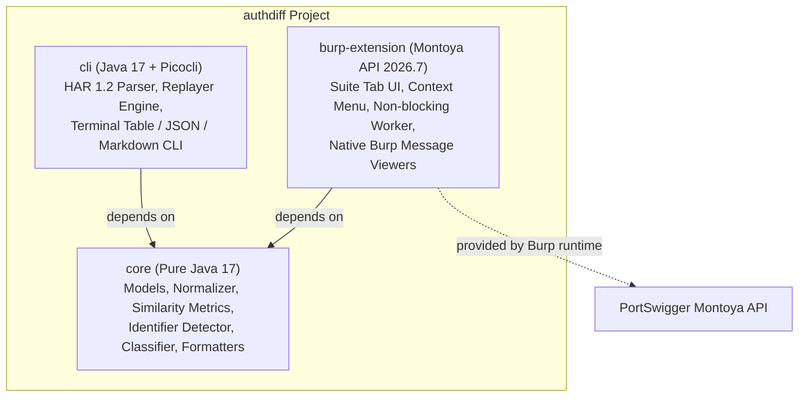
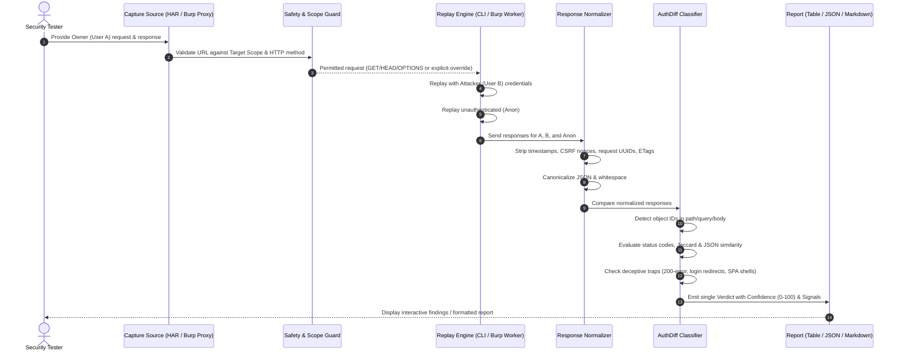

# authdiff Architecture & Technical Design

`authdiff` is an open-source authorization diffing engine designed to detect Broken Object Level Authorization (BOLA / IDOR) and Missing Authentication vulnerabilities. It operates both as a standalone command-line tool and as a Burp Suite Community-compatible extension.

---

## 1. Module Hierarchy

The project is structured as a clean, decoupled multi-module Gradle project:

### Module Responsibilities
- **`core`**: Contains zero dependencies on Burp Suite or CLI frameworks. Implements pure domain models (`HttpRequest`, `HttpResponse`, `ExchangePair`, `AuthDiffFinding`), response normalizers, similarity algorithms, heuristic trap detectors, and the classification decision tree.
- **`cli`**: Provides offline HAR 1.2 parsing, an active HTTP client replayer with rate-limiting and scope protection, and terminal formatters.
- **`burp-extension`**: Integrates into Burp Suite Community Edition using the official PortSwigger Montoya API. Provides interactive UI controls, context menu integration, and native message viewers.

---

## 2. Detection Data Flow

---

## 3. Core Design Decisions & Rationales

### A. Token-Set Jaccard Similarity vs. Levenshtein Edit Distance
- **Problem:** Naive character or token edit distance algorithms (e.g. Wagner-Fischer Levenshtein) have quadratic complexity:
  $$\mathcal{O}(N \times M)$$
  On modern HTTP responses containing 50KB–500KB of JSON or HTML, edit distance causes prohibitive CPU spikes or `OutOfMemoryError` conditions. Furthermore, JSON property ordering can vary without semantic meaning.
- **Solution:** `authdiff` uses **Token-Set Jaccard Similarity**:
  $$J(A, B) = \frac{|A \cap B|}{|A \cup B|}$$
  This executes in linear time $\mathcal{O}(N + M)$ using hash sets, is completely deterministic, strictly bounded between `[0.0, 1.0]`, and is invariant to arbitrary key reordering.
- **For JSON Payloads:** `authdiff` supplements token-set Jaccard with `JsonStructuralComparator`, which decomposes JSON trees into key paths and values, measuring schema key-set overlap and value overlap independently.

### B. Response Normalization & Dynamic Noise Filtering
- Modern web applications inject dynamic volatile tokens on every request:
  - Timestamps (ISO-8601 strings, UNIX epoch integers)
  - CSRF nonces (`csrf_token`, `authenticity_token`, `__RequestVerificationToken`)
  - Tracing identifiers (`X-Request-ID`, `traceparent`, `cf-ray`)
  - Caching headers (`ETag`, `Date`, `Last-Modified`)
- `ResponseNormalizer` applies deterministic regular expression replacements and JSON AST walks to replace these volatile values with static tokens (`<VOLATILE>`, `<TIMESTAMP>`) before computing similarity scores.

### C. Conservative Classification: Prefer INCONCLUSIVE to False Positives
- In authorization testing, false positives erode auditor trust. Common traps include:
  1. **200 OK with Error Payload:** APIs returning HTTP 200 with `{"error": "Access Denied"}` or `{"success": false}`.
  2. **Redirect to Login:** 302/307 redirects to `/login` or `/auth`.
  3. **SPA HTML Shells:** Single Page Applications returning the same `index.html` shell for any requested URI.
  4. **Public Endpoints:** Resources that legitimately return identical content to all visitors.
- `authdiff` implements explicit trap detectors. If an endpoint returns identical content across User A, User B, and Anon, but lacks an object identifier, it lowers confidence and marks the result as `INCONCLUSIVE` rather than flagging an IDOR.

### D. Safety Defaults
- **Method Restriction:** Replays are restricted to safe HTTP methods (`GET`, `HEAD`, `OPTIONS`) by default. State-changing verbs (`POST`, `PUT`, `PATCH`, `DELETE`) require explicit user consent (`--allow-unsafe-methods` or UI checkbox).
- **Scope Restriction:** Replays are strictly limited to user-specified hosts. Any request outside the defined scope is refused before network transmission.
- **Rate Limiting:** Built-in rate limiter (default: 2.0 req/s) prevents accidental denial of service against test environments.
- **Credential Redaction:** Authorization headers, cookies, and tokens are redacted (`[REDACTED]`) in all logs, exports, and reports by default.

### E. Burp Suite Community Edition Compatibility
- Unlike many commercial extensions, `authdiff` avoids any Pro-only interfaces (such as Burp Scanner or Collaborator).
- It relies entirely on the modern, non-deprecated **Montoya API** (`net.portswigger.burp.extensions:montoya-api:2026.7`).
- All background HTTP tasks run on a dedicated worker pool off the Swing Event Dispatch Thread (EDT) to ensure the Burp UI remains responsive.
